# Poly Haven: Architecture models

**14 assets from [Poly Haven](https://polyhaven.com), dedicated to the public domain under [CC0](https://polyhaven.com/license).** Use them in any game, free or paid, and change them however you like; no credit is needed.

3D models as glTF at 1K and 2K texture resolution, each folder self-contained (`.gltf`, `.bin`, `textures/`). 339.9 MB in all.

This is a copy kept by [zuujis-cc0](https://github.com/zuujis-cc0) so game makers can take single files from GitHub. It is not made by or affiliated with Poly Haven: the originals, often in more formats and higher resolutions, are on [polyhaven.com](https://polyhaven.com). If they help you, consider [supporting Poly Haven](https://www.patreon.com/polyhaven/overview).

Every file is listed in [MANIFEST.tsv](MANIFEST.tsv) with its size and SHA-256. More free assets: [the Zuujis collection](https://github.com/zuujis-cc0/free-game-assets#readme).

| | | | |
| :-: | :-: | :-: | :-: |
| <a href="gate_latch_01">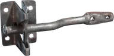</a> <b><a href="gate_latch_01">Gate Latch 01</a></b> by Desktoy · <a href="https://polyhaven.com/a/gate_latch_01">source</a> | <a href="large_castle_door">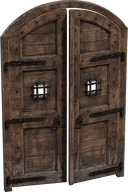</a> <b><a href="large_castle_door">Large Castle Door</a></b> by Tina · <a href="https://polyhaven.com/a/large_castle_door">source</a> | <a href="large_iron_gate">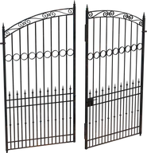</a> <b><a href="large_iron_gate">Large Iron Gate</a></b> by Josh Dean · <a href="https://polyhaven.com/a/large_iron_gate">source</a> | <a href="modular_chainlink_fence">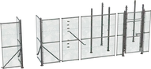</a> <b><a href="modular_chainlink_fence">Modular Chainlink Fence</a></b> by Amal Kumar, James Ray Cock · <a href="https://polyhaven.com/a/modular_chainlink_fence">source</a> |
| <a href="modular_factory_facade">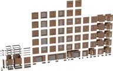</a> <b><a href="modular_factory_facade">Modular Factory Facade</a></b> by James Ray Cock · <a href="https://polyhaven.com/a/modular_factory_facade">source</a> | <a href="modular_fire_escape">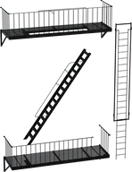</a> <b><a href="modular_fire_escape">Modular Fire Escape</a></b> by Juniix · <a href="https://polyhaven.com/a/modular_fire_escape">source</a> | <a href="modular_fort_01">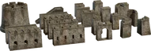</a> <b><a href="modular_fort_01">Modular Fort 01</a></b> by Rico Cilliers · <a href="https://polyhaven.com/a/modular_fort_01">source</a> |  <b><a href="modular_urban_apartments_facade">Modular Urban Apartments Facade</a></b> by James Ray Cock · <a href="https://polyhaven.com/a/modular_urban_apartments_facade">source</a> |
| <a href="modular_wooden_pier">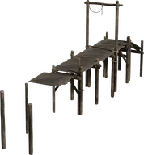</a> <b><a href="modular_wooden_pier">Modular Wooden Pier</a></b> by Rico Cilliers · <a href="https://polyhaven.com/a/modular_wooden_pier">source</a> | <a href="rollershutter_door">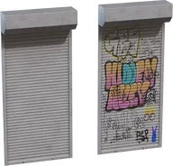</a> <b><a href="rollershutter_door">Rollershutter Door</a></b> by MP · <a href="https://polyhaven.com/a/rollershutter_door">source</a> | <a href="rollershutter_window_01">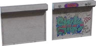</a> <b><a href="rollershutter_window_01">Rollershutter Window 01</a></b> by MP · <a href="https://polyhaven.com/a/rollershutter_window_01">source</a> | <a href="rollershutter_window_02">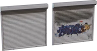</a> <b><a href="rollershutter_window_02">Rollershutter Window 02</a></b> by MP · <a href="https://polyhaven.com/a/rollershutter_window_02">source</a> |
| <a href="rollershutter_window_03">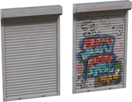</a> <b><a href="rollershutter_window_03">Rollershutter Window 03</a></b> by MP · <a href="https://polyhaven.com/a/rollershutter_window_03">source</a> | <a href="stone_fire_pit">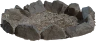</a> <b><a href="stone_fire_pit">Stone Fire Pit</a></b> by Sebastian Platen · <a href="https://polyhaven.com/a/stone_fire_pit">source</a> |  |  |

---

Kept up to date by this repository's own [update workflow](.github/workflows/update.yml), with code and plan from [cc0-mirror](https://github.com/zuujis-cc0/cc0-mirror). Something wrong? [Open an issue there](https://github.com/zuujis-cc0/cc0-mirror/issues/new) or use the [private report form](https://games.zuujis.com/report).
